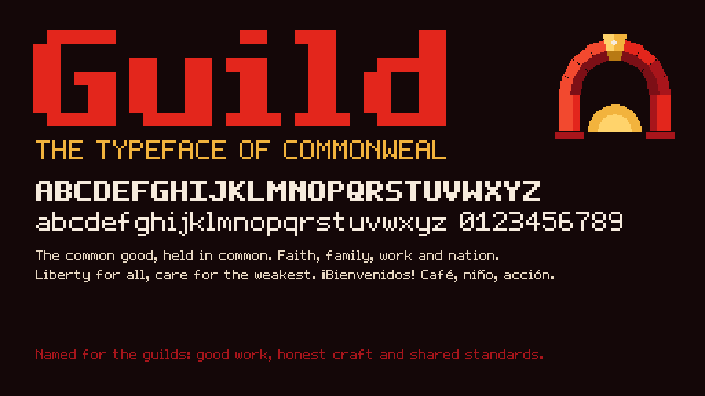

# Guild



**Guild** is the typeface of Commonweal: an original 5×7 pixel face, in Regular and Bold. It's named for the
guilds, the old associations of workers that kept good work, honest craft and shared standards alive from
generation to generation.

| File | Use |
|---|---|
| `Guild-Regular.ttf`, `Guild-Bold.ttf` | Install on your computer, or use in apps and print |
| `Guild-Regular.woff`, `Guild-Bold.woff` | For the web |

**Character set:** A–Z, a–z, 0–9, `. , : ; ' " - – — _ ! ¡ ? ¿ / \ & ( ) [ ] + = * # % @ $ < > ·`, the
accented letters á é í ó ú ü ñ, and ★.

**Sizing:** each pixel of the design is 100 units on a 1000-unit em, so the capitals are 7 pixels tall at
10 px. For perfectly crisp edges, set Guild at multiples of 10 px and turn off font smoothing for headings.

**Bold** is the classic pixel bold: every stroke is one pixel wider to the right. M, W, m and w are drawn
separately in Bold, because doubling their diagonals would fill them in.

## Changing it

The glyphs are drawn as plain text in [tools/font/guild-glyphs.json](../../tools/font/guild-glyphs.json),
where `#` is ink. Hand-drawn bold letters go in its `boldOverrides`. To add or redraw a letter, edit that file
and run:

```bash
python3 tools/font/build_font.py
```

The builder uses only Python's standard library. It traces each glyph's pixels into one clean outline and
writes the TTF and WOFF files here. The art studio draws text from the same glyph file, so the logos and the
font always match.

## Licence

Guild’s original sources and future regenerated fonts use the [Commonweal License 1.0](../../LICENSE), whose legal terms are GPLv3 only.
Existing font files retain their [SIL Open Font License 1.1](OFL.txt) permissions, with no reserved font
name. See [LICENSING.md](../../LICENSING.md) for the repository-wide scope and earlier grants.
