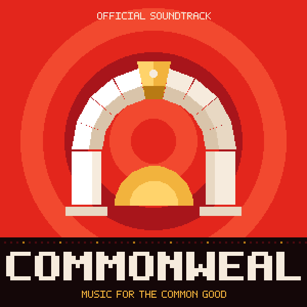

# Commonweal: Music for the Common Good

The official soundtrack of Commonweal: eight original chiptune pieces, composed and rendered with **Vigil Box**.
Together they run about 16 minutes.

| # | Title | | Key | Tempo | Length |
|---|---|---|---|---|---|
| 1 | [Keystone](mp3/01-keystone.mp3) | Theme of Commonweal | D minor | 108 | 2:07 |
| 2 | [Open Standard](mp3/02-open-standard.mp3) | Every part compatible | E minor | 140 | 1:51 |
| 3 | [Early Warning](mp3/03-early-warning.mp3) | Signals in the numbers | A minor | 124 | 1:50 |
| 4 | [Algedonic Signal](mp3/04-algedonic-signal.mp3) | The alarm that skips the queue | C minor to C major | 96 | 2:03 |
| 5 | [Supply Lines](mp3/05-supply-lines.mp3) | The trucks keep rolling | G major | 132 | 1:44 |
| 6 | [Hearth](mp3/06-hearth.mp3) | A waltz for home and tradition | F major, 3/4 | 88 | 1:57 |
| 7 | [Viable System](mp3/07-viable-system.mp3) | Systems within systems | D minor | 72 | 2:43 |
| 8 | [Commonweal](mp3/08-commonweal.mp3) | Finale | D major | 112 | 2:02 |

## Notes on the tracks

1. **Keystone.** The main theme. A bell melody rises stone by stone over a minor progression and builds to a
   full band, the way an arch only stands once its keystone is set.
2. **Open Standard.** One shared format carried to every corner of the nation, so every machine can talk to
   every other. Sixteenth-note arpeggios and a clipped, repeated lead: always transmitting.
3. **Early Warning.** A steady four-on-the-floor pulse with a lead that keeps measuring and answering. Problems
   are caught early, by the people closest to them.
4. **Algedonic Signal.** Stafford Beer's pain-and-pleasure alarm, which cuts through every layer to reach
   whoever can act. A two-note bell alarm sounds over C minor. In the last section the harm is answered, and
   the piece resolves into C major.
5. **Supply Lines.** When supply is threatened, coordination keeps food and fuel moving to every town. Bright
   and driving, in G major: the nation looking after its own.
6. **Hearth.** A gentle waltz on plucked strings and organ, for family, faith and the customs handed down.
7. **Viable System.** Beer's model of a system that governs itself, where every whole is made of wholes, like
   commonwealths within commonwealths. The bell melody is answered by itself in canon, an octave lower and one
   bar behind.
8. **Commonweal.** The Keystone theme returns in D major: the common good, held in common.

## Files

- `mp3/`: 256 kbps MP3s, 44.1 kHz stereo, tagged with titles, track numbers and cover art.
- `album.json`: the track list with keys, tempos and lengths, for players and the website.
- `commonweal-soundtrack-cover-3000.png` (streaming services) and `-600.png` (web and tags).
- `../src/box/*.song.json`: every track as an editable Vigil Box song. Open one in Vigil Box to change it.
- `wav/` (not in git): 16-bit WAV masters. Regenerate them with [tools/studio](../../tools/studio/README.md).

**Mastering:** each track is matched to −16 dBFS RMS, with soft-knee limiting that keeps peaks under −1 dBFS,
so the album plays at an even level.

## How it was made

The melodies were written note by note. Vigil Box's song tools generated the bass, arpeggio, pad and drum parts
from each section's chord progression. Every track was then balanced against Vigil Box's own per-channel audio
analysis and rendered with its BeepBox synth. The score is code in
[tools/studio/music.js](../../tools/studio/music.js), so anyone can read, change and re-render it.

## Licence

*Commonweal: Music for the Common Good* by the Commonweal contributors is shared under
[Commonweal License 1.0](../../LICENSE). Play it, remix it, share it, and credit Commonweal under its
terms. Existing CC BY-SA 4.0 grants and embedded notices remain valid; see [LICENSING.md](../../LICENSING.md). Vigil Box is built on BeepBox by John Nesky (MIT) and uses lamejs (LGPL) for MP3 encoding.
